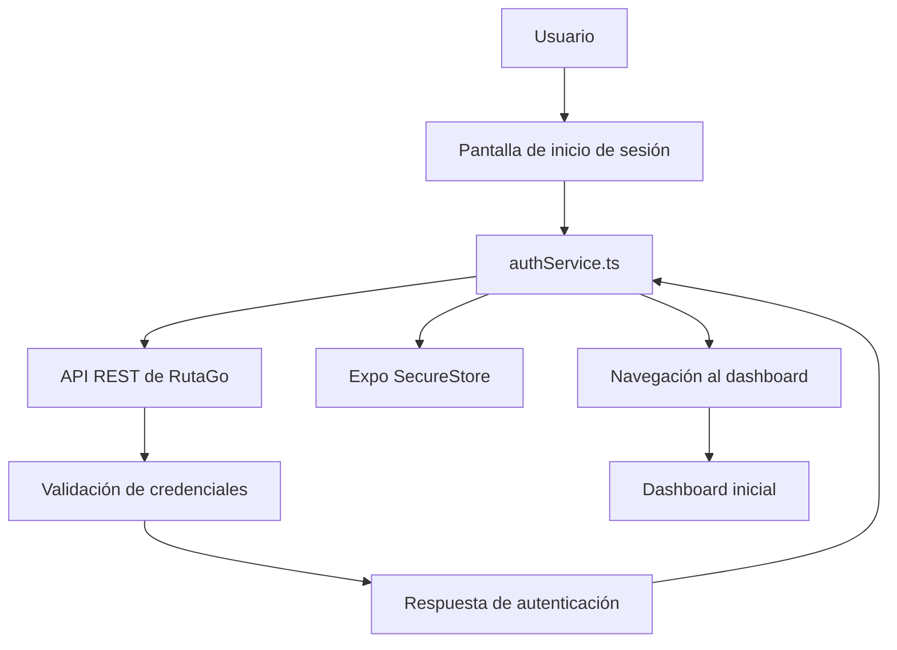
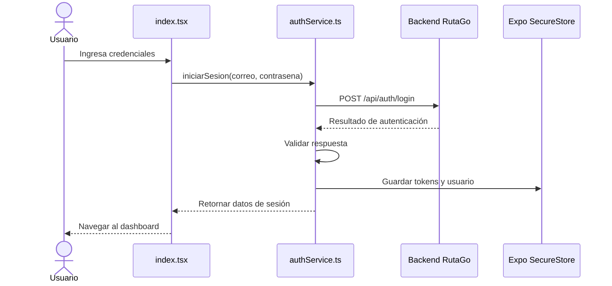

# RutaGo Mobile

## 1. Descripción del proyecto

RutaGo Mobile es el cliente móvil del sistema RutaGo, una plataforma de movilidad que busca facilitar la gestión de los servicios de transporte y la interacción entre los diferentes tipos de usuarios.

La aplicación se desarrolla con React Native, Expo y TypeScript. Su arquitectura separa las pantallas, los componentes visuales, los hooks y los servicios encargados de la comunicación con el backend.

Actualmente, la aplicación cuenta con una pantalla de inicio de sesión integrada con la API de RutaGo, persistencia de la información de autenticación mediante Expo SecureStore y un dashboard inicial que presenta información básica del usuario autenticado.

El desarrollo continúa de forma incremental, incorporando las funcionalidades móviles y su integración con los módulos del backend.

## 2. Objetivos técnicos

- Implementar una aplicación móvil multiplataforma.
- Consumir los servicios REST expuestos por el backend de RutaGo.
- Centralizar las solicitudes de autenticación en un servicio independiente.
- Mantener separados los componentes de interfaz y la lógica de comunicación con la API.
- Almacenar los datos de sesión utilizando un mecanismo de almacenamiento seguro.
- Facilitar la incorporación progresiva de los módulos funcionales del sistema.

## 3. Tecnologías y herramientas

| Tecnología | Responsabilidad |
|---|---|
| React Native | Construcción de interfaces móviles. |
| Expo | Entorno de desarrollo y ejecución de la aplicación. |
| TypeScript | Definición de tipos y contratos de datos. |
| Expo Router | Organización de pantallas y navegación basada en archivos. |
| Expo SecureStore | Persistencia local de credenciales de sesión y datos asociados. |
| Fetch API | Comunicación HTTP con el backend. |
| Node.js y npm | Entorno de herramientas y gestión de dependencias. |
| Git y GitHub | Control de versiones y almacenamiento del código fuente. |

## 4. Arquitectura de la aplicación

La aplicación utiliza una organización por responsabilidades. Las pantallas administran la presentación y la interacción con el usuario, mientras que los servicios encapsulan las operaciones de comunicación con el backend.



### Responsabilidades principales

- `src/app/`: contiene las pantallas y la configuración de navegación.
- `src/components/`: contiene componentes reutilizables de interfaz.
- `src/constants/`: organiza constantes compartidas.
- `src/hooks/`: permite encapsular lógica reutilizable de la aplicación.
- `src/services/`: contiene los servicios de comunicación con la API.

Esta separación permite modificar una pantalla sin concentrar en ella toda la lógica de acceso al servidor.

## 5. Estructura del proyecto

```text
rutago-mobile/
├── assets/
├── scripts/
├── src/
│   ├── app/
│   │   ├── _layout.tsx
│   │   ├── index.tsx
│   │   └── dashboard.tsx
│   ├── components/
│   ├── constants/
│   ├── hooks/
│   └── services/
│       └── authService.ts
├── app.json
├── package.json
├── package-lock.json
├── tsconfig.json
└── README.md
```

### Archivos relevantes

**`src/app/index.tsx`**

Contiene la pantalla inicial de autenticación, los campos de correo electrónico y contraseña, y la interacción que permite iniciar sesión.

**`src/app/_layout.tsx`**

Define la estructura de navegación de la aplicación mediante Expo Router.

**`src/app/dashboard.tsx`**

Implementa el dashboard inicial, que consulta la información guardada del usuario para presentar su nombre y rol.

**`src/services/authService.ts`**

Centraliza la petición de inicio de sesión, valida la respuesta del backend y almacena los datos de sesión cuando la autenticación es satisfactoria.

## 6. Integración con el backend

La aplicación consume la API REST del backend de RutaGo.

- URL base: `https://rutago-backend-a303.onrender.com`
- Documentación de la API: https://rutago-backend-a303.onrender.com/api/docs
- Endpoint de autenticación: `POST /api/auth/login`

La URL base se encuentra configurada en `src/services/authService.ts`.

### Contrato de la solicitud

El inicio de sesión utiliza una petición HTTP con contenido JSON:

```http
POST /api/auth/login
Content-Type: application/json
```

Ejemplo del cuerpo de la solicitud:

```json
{
  "correo": "usuario@ejemplo.com",
  "contrasena": "contraseña"
}
```

El correo se normaliza mediante `trim()` antes de enviarlo. La contraseña se envía sin modificar.

### Respuesta de autenticación

El servicio espera una respuesta con información de éxito, un mensaje y los datos necesarios para mantener la sesión.

La estructura tipada contempla los siguientes campos:

```typescript
interface LoginResponse {
  success: boolean;
  message: string;
  token?: string;
  refreshToken?: string;
  usuario?: {
    id: number | string;
    nombres: string;
    rol: {
      id: number | string;
      nombreRol: string;
    } | null;
  };
}
```

Si la respuesta HTTP no es satisfactoria, si el backend informa que la autenticación falló o si faltan los datos esenciales de sesión, el servicio genera un error para que la interfaz pueda informar al usuario.

## 7. Flujo de autenticación

El proceso implementado sigue esta secuencia:

1. El usuario ingresa su correo y contraseña.
2. La pantalla invoca la función `iniciarSesion()`.
3. `authService.ts` envía las credenciales al endpoint de autenticación.
4. El backend valida las credenciales y devuelve la respuesta.
5. El servicio verifica el resultado y la presencia del token, el token de actualización y los datos del usuario.
6. Cuando la autenticación es satisfactoria, se almacenan los datos de sesión mediante Expo SecureStore.
7. La aplicación navega al dashboard inicial.



## 8. Persistencia de la sesión

La implementación utiliza Expo SecureStore para almacenar los siguientes valores:

| Clave de almacenamiento | Contenido |
|---|---|
| `rutago_token` | Token de acceso. |
| `rutago_refresh_token` | Token de actualización. |
| `rutago_user` | Información básica del usuario en formato JSON. |

Este mecanismo permite mantener los datos de sesión disponibles localmente entre ejecuciones, según el comportamiento de la plataforma.

El almacenamiento de tokens no reemplaza la validación de permisos en el backend. Las operaciones protegidas deben seguir verificando la autenticación y autorización correspondientes.

La renovación automática del token, el cierre de sesión completo y la recuperación de una sesión existente deben integrarse y verificarse como parte de la evolución del módulo de autenticación.

## 9. Navegación

La aplicación utiliza Expo Router para organizar la navegación mediante archivos dentro de `src/app/`.

Las pantallas principales documentadas en esta etapa son:

- `index.tsx`: inicio de sesión.
- `dashboard.tsx`: dashboard inicial.
- `_layout.tsx`: configuración de navegación.

Después de una autenticación satisfactoria, la pantalla de inicio de sesión utiliza navegación programática para dirigir al usuario al dashboard.

La navegación y las pantallas específicas por rol deben ampliarse a medida que se implementen los módulos móviles.

## 10. Instalación y ejecución en desarrollo

### Requisitos

- Node.js compatible con la versión de Expo configurada en el proyecto.
- npm.
- Git.
- Expo Go o un entorno de ejecución compatible con el SDK utilizado.

### Clonar el repositorio

```bash
git clone https://github.com/Ruta-Go/rutago-mobile.git
cd rutago-mobile
```

### Instalar dependencias

```bash
npm install
```

### Iniciar Expo

```bash
npx expo start
```

Para reiniciar la caché de Metro cuando se presenten problemas de actualización:

```bash
npx expo start --clear
```

La aplicación puede abrirse en un dispositivo o emulador compatible. Para utilizar Expo Go, debe verificarse la compatibilidad de su versión con el SDK del proyecto.

### Verificación básica

Después de iniciar la aplicación:

1. Comprobar que la pantalla de inicio de sesión se visualiza correctamente.
2. Confirmar que el dispositivo tiene conexión a internet.
3. Probar el inicio de sesión con una cuenta de prueba autorizada.
4. Verificar la navegación al dashboard.
5. Revisar los mensajes de error ante credenciales incorrectas o fallos de conexión.

## 11. Consideraciones de seguridad

- No almacenar contraseñas en texto plano en el dispositivo.
- No incluir credenciales reales, tokens ni secretos en el repositorio.
- Utilizar HTTPS para las comunicaciones con el backend desplegado.
- Tratar los tokens como información sensible.
- Validar las respuestas HTTP y los datos recibidos antes de utilizarlos.
- No considerar la información del cliente como sustituto de los controles de autorización del servidor.
- Evitar exponer información sensible en registros de depuración.

## 12. Control de versiones

El código fuente se administra mediante Git y se publica en GitHub.

Repositorio:

https://github.com/Ruta-Go/rutago-mobile

Para revisar el estado local de los archivos:

```bash
git status
```

Para registrar un cambio:

```bash
git add README.md
git commit -m "Actualiza documentacion tecnica del movil"
```

Para publicar los cambios en la rama de trabajo actual:

```bash
git push origin feature-ASEG1999
```

Antes de ejecutar estos comandos, se debe comprobar la rama activa con `git branch --show-current`. La rama principal y la rama de desarrollo deben mantenerse coordinadas mediante el flujo de integración definido para el proyecto.

## 13. Estado actual y trabajo pendiente

### Implementado

- Estructura inicial de la aplicación móvil.
- Pantalla de inicio de sesión.
- Integración del inicio de sesión con el backend desplegado.
- Validación básica de la respuesta de autenticación.
- Almacenamiento de tokens y datos del usuario con Expo SecureStore.
- Navegación al dashboard inicial.
- Presentación básica del nombre y rol del usuario autenticado.

### Pendiente de desarrollo o validación

- Implementación de los módulos funcionales de pasajeros y conductores.
- Integración de los módulos de viajes, rutas, horarios y vehículos.
- Navegación y permisos específicos según el rol del usuario.
- Recuperación y renovación de sesiones.
- Cierre de sesión y eliminación de los datos de sesión.
- Manejo uniforme de errores de red y respuestas del servidor.
- Pruebas automatizadas y validación en dispositivos físicos.
- Verificación de accesibilidad, rendimiento y experiencia de usuario.

Estas funcionalidades deben considerarse pendientes hasta que su implementación y funcionamiento hayan sido comprobados.

## 14. Conclusión

RutaGo Mobile constituye el cliente móvil del sistema RutaGo. Su desarrollo parte de una arquitectura organizada por responsabilidades, con una primera integración de autenticación contra el backend y almacenamiento local de los datos de sesión.

La estructura actual permite continuar incorporando funcionalidades de manera incremental, conservando la separación entre interfaz, navegación y servicios de acceso a la API.
